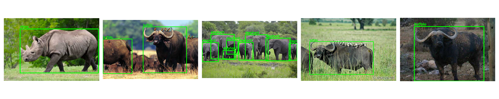
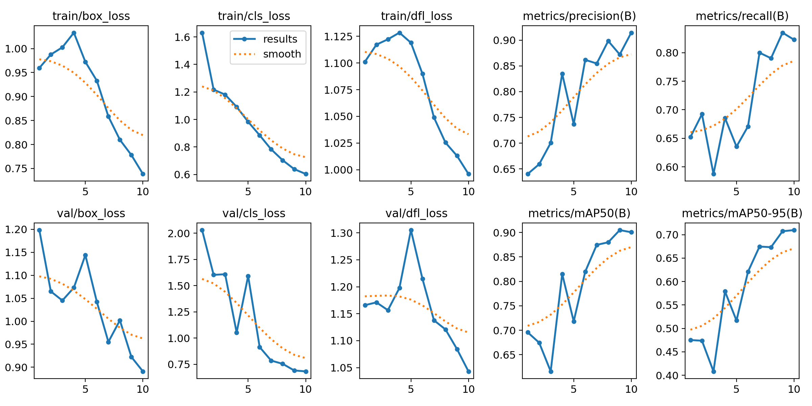
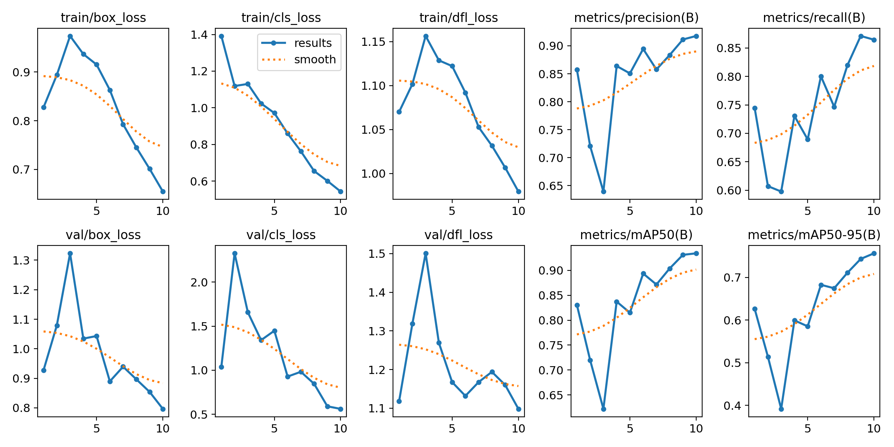
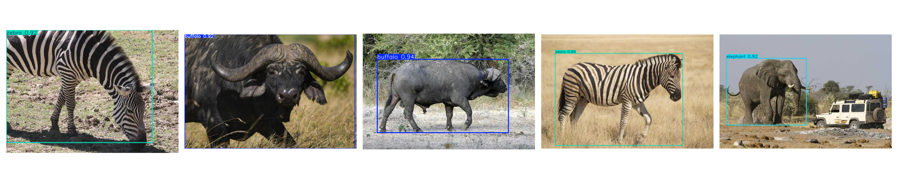
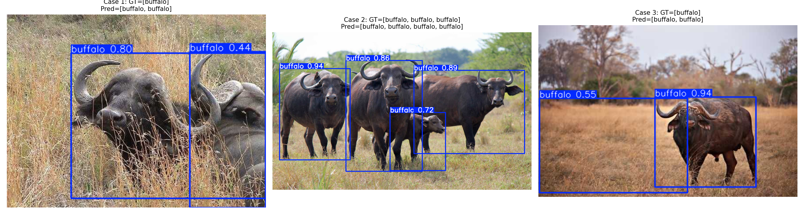

# African Wildlife Object Detection 

## 1. Task Description
This repository provides a reproducible Google Colab pipeline to fine-tune a pretrained object detector (**YOLOv8n**) on the **African Wildlife** dataset, perform a controlled hyperparameter experiment, evaluate the selected model on a held-out test set, and analyze failure cases.

---

## 2. Dataset Information
* **Source:** Public *African Wildlife* object detection dataset distributed via Ultralytics assets (`https://github.com/ultralytics/assets/releases/download/v0.0.0/african-wildlife.zip`).
* **Usage Terms:** Open-access dataset provided for educational and research benchmarking.
* **Classes (4):** `0: buffalo`, `1: elephant`, `2: rhino`, `3: zebra`.
* **Annotation Format:** YOLO normalized bounding-box format (`class_id x_center y_center width height` in `.txt` files).
* **Data Splits & Integrity Check:** The dataset uses pre-defined, non-overlapping `train`, `val`, and `test` splits (`seed=42` used for sampling visualizations). All label files were verified: **0 missing or empty annotation files** were found across all splits.

| Split | Images | Annotated Objects | Empty Label Files |
| :--- | :---: | :---: | :---: |
| **Train** | 1,052 | 1,931 | 0 |
| **Validation** | 225 | 379 | 0 |
| **Test** | 227 | 375 | 0 |
| **Total** | **1,504** | **2,685** | **0** |

### Ground-Truth Annotation Samples

---

## 3. Setup and Run Instructions
1. Click the **Open in Colab** badge at the top of this README.
2. (Optional) Select **Runtime → Change runtime type → T4 GPU** for faster training (the notebook also runs reproducibly on standard CPU).
3. Run all cells sequentially (`Runtime → Run all`). The notebook automatically installs pinned dependencies (`ultralytics==8.4.216`), downloads the dataset, trains both models, evaluates on `val` and `test`, and generates visualizations.
4. **Final Weights Download:** Download the trained `best_exp_imgsz384.pt` checkpoint from [Google Drive](https://drive.google.com/file/d/15TTf34UMFRfhWnHDkeWMdWHfiLoM0Cyr/view?usp=share_link).

---

## 4. Training & Controlled Experiment
Both runs were fine-tuned from the same pretrained checkpoint (`yolov8n.pt`, COCO weights) with fixed data splits, `epochs=10`, `batch=16`, `optimizer=AdamW (auto)`, and `seed=42` (`deterministic=True`).

* **Controlled Change:** Input image resolution (`imgsz`) increased from `256` (Baseline) to `384` (Experiment).
* **Hypothesis:** Increasing `imgsz` from `256×256` to `384×384` preserves finer spatial details of distant or partially occluded animals against savannah backgrounds, which should increase **Recall** and **mAP@0.50** on the validation set at the cost of longer training time.

### Validation Comparison (`val` split)

| Run | Changed Setting (`imgsz`) | Precision (P) | Recall (R) | mAP@0.50 | Training Time (CPU) |
| :--- | :---: | :---: | :---: | :---: | :---: |
| **Baseline** | `256` | 0.9151 | 0.8228 | 0.9005 | 28.99 min (1,739.5 s) |
| **Experiment** | `384` | **0.9167** | **0.8680** | **0.9345** | 57.64 min (3,458.3 s) |

* **Explanation:** The hypothesis was confirmed. Increasing resolution to `384` improved **Recall by +4.52 percentage points** (`0.8228 → 0.8680`) and **mAP@0.50 by +3.40 percentage points** (`0.9005 → 0.9345`), while doubling CPU compute time (`28.99 → 57.64 min`). Therefore, `exp_imgsz384` was selected as the final model.

### Learning Curves
| Baseline (`imgsz=256`) | Experiment (`imgsz=384`) |
| :---: | :---: |
|  |  |

---

## 5. Final Test Evaluation & Error Analysis
The selected checkpoint (`exp_imgsz384/weights/best.pt`) was evaluated once on the held-out `test` split (227 images, 375 objects) using **`conf=0.25`** and **`IoU=0.50`**.

| Metric | Value | What It Measures |
| :--- | :---: | :--- |
| **Precision (P)** | **0.9571** | Fraction of predicted boxes (`IoU ≥ 0.50`, `conf ≥ 0.25`) that correctly match a ground-truth object (`TP / (TP + FP)`). |
| **Recall (R)** | **0.9024** | Fraction of actual ground-truth objects successfully detected by the model (`TP / (TP + FN)`). |
| **mAP@0.50** | **0.9165** | Mean Average Precision across all 4 classes computed as the area under the Precision–Recall curve at an `IoU` threshold of `0.50`. |

### Test Set Predictions (5 Examples)

### Failure Case Analysis (3 Test Examples)

1. **Case 1 (`1 (154).jpg`) — Ground Truth: `[buffalo]` | Predicted: `[buffalo, buffalo]`:**
   * **Likely Cause:** Duplicate detection / split bounding box on a single large animal or an unannotated background buffalo partially occluded by vegetation. When two boxes overlap with `IoU` slightly below the NMS suppression threshold, both survive as `buffalo`, creating one False Positive.
2. **Case 2 (`1 (192).jpg`) — Ground Truth: `[buffalo, buffalo, buffalo]` | Predicted: `[buffalo, buffalo, buffalo, buffalo]`:**
   * **Likely Cause:** Herd occlusion and dark coat similarity. In tightly packed groups of buffaloes, overlapping limbs and heads cause the detector to predict an extra box for a partially visible background animal that was omitted in ground-truth labeling.
3. **Case 3 (`1 (317).jpg`) — Ground Truth: `[buffalo]` | Predicted: `[buffalo, buffalo]`:**
   * **Likely Cause:** Low confidence threshold (`conf=0.25`) combined with visual ambiguity in shadows/horns, producing a secondary lower-confidence bounding box on the same animal.
* **Practical Next Step:** Tune the inference confidence threshold (e.g., increasing `conf` from `0.25` to `0.40` on the validation set) and apply Mosaic/MixUp or copy-paste augmentation during training to reduce duplicate detections in crowded herds.

---

## 6. Limitations & AI Acknowledgment
* **Limitations:** Trained for 10 epochs on CPU at `384×384` resolution; performance may degrade on very small distant animals or heavy night/low-light scenes, and dense herds can trigger duplicate boxes at low confidence thresholds.
* **AI Assistance Acknowledgment:** An AI assistant (Gemini) was used for project structuring, debugging Colab/Ultralytics environment compatibility (`numpy>=2.0` / Python 3.13), and drafting documentation. All experiments, code execution, metric evaluations, and visual inspections were performed and verified by the author.
